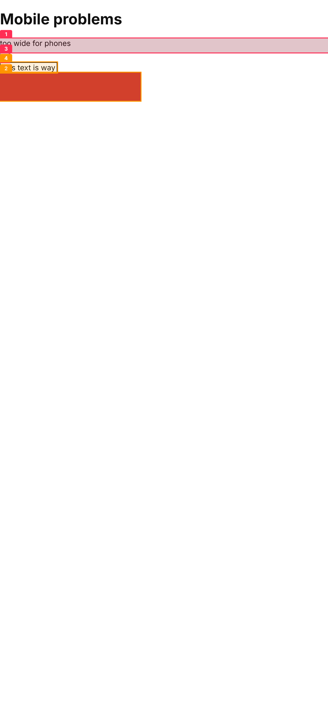

# Sightline

**Your AI can write UI. Sightline lets it actually see it.**

Coding agents build interfaces blind: they can't tell that the text is unreadable, the photo is stretched, the button is 20px wide, or the Arabic page is mirrored wrong. Sightline renders your page in a real browser (phone + desktop), finds those defects, and hands the agent **annotated screenshots and a ranked fix list** it can act on.



## Quick start

```bash
npx playwright install chromium   # once
npx sightline ./index.html        # or http://localhost:3000
```

Output (Markdown for the agent + `report.html` + annotated PNGs in `./sightline-out`):

```
# Sightline report — score 78/100 (C)
1. 🔴 overflow-x — Page scrolls sideways: content is 310px wider than the 390px viewport.
2. 🔴 tap-target — Touch target is only 20×20px ...
3. 🟠 image-crop — only 10% of the photo is visible ...
```

## Use it with Claude Code (or any agent)

```text
/plugin marketplace add khaled-cods/sightline
/plugin install sightline@sightline
```

The bundled skill tells the agent to run the audit after every UI change and loop until the score is ≥ 90. For other agents, copy `skills/sightline/SKILL.md` into your rules file.

## What it checks

| Area | Rules |
|---|---|
| Layout | horizontal overflow, clipped text, stretched or over-cropped images, line length |
| Touch | tap targets < 44px (phone viewport) |
| Accessibility | WCAG AA contrast, alt text, labels, button names, heading order, `lang`, viewport meta, focus outlines |
| Type | tiny text, too many font families |
| **Arabic / RTL** | missing `dir="rtl"`, letter-spacing on Arabic, Latin-only fonts, physical left/right CSS, forced `text-align:left`, wrong-way arrows |

## CLI

```
sightline <url|file> [--out dir] [--viewports mobile,tablet,desktop] [--dark] [--json] [--fail-under 90]
```

`--fail-under` makes it a CI gate. See `.github/workflows/ci.yml`.

## Honest limits

Heuristic, not a designer: it catches objective defects, not taste. Contrast over gradients/images is skipped rather than guessed. Pages behind a login need a dev URL that's already reachable.

## License

MIT
